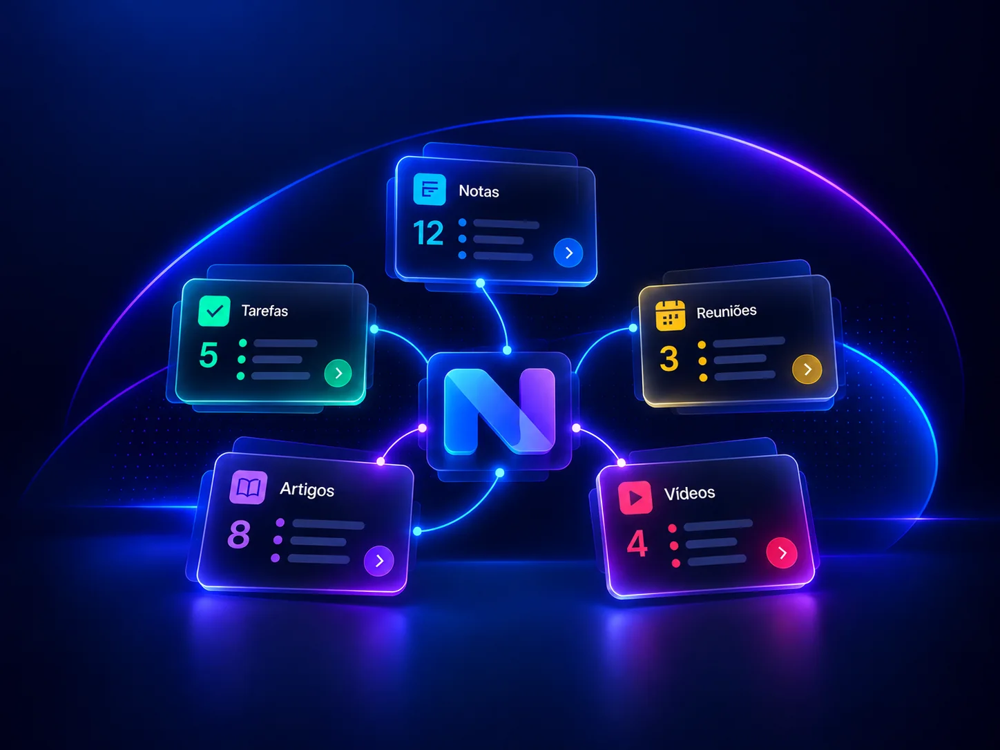

<p align="center">
  
</p>

<h1 align="center">VixNotes</h1>

<p align="center"><strong>Tasks, notes, meetings, articles and videos in one calm place. Only yours.</strong></p>

<p align="center">
  <a href="https://github.com/cjsrodrigues/vixnotes-releases/releases/latest"><strong>Download for Windows</strong></a>
  &nbsp;·&nbsp; by <a href="https://github.com/cjsrodrigues">vixcode</a>
</p>

---

## Your head is full. Your tools are scattered.

A to-do app here, a notes app there, meeting minutes in a document, articles saved in a browser tab you will never open again, and
a video you meant to watch last month. Everything you know ends up in five places, and you remember none of them.

**VixNotes puts it all in one app that opens in a second, runs on your own computer, and keeps what matters connected.**

## What you can do with it

### Tasks that keep you focused
Opens on your tasks, because that is what you need first. Projects, priorities, due dates, tags and people. Tasks that **repeat**
(daily, weekly, monthly, yearly) open the next one when you finish. An "attention" view shows what is late or due soon. Sort the
way you think: by due date, priority or last change.

### Notes that become knowledge
Write in a clean rich-text editor, or switch to **Markdown** with a live preview. Organize with tags, find anything in a blink with
full-text search (`Ctrl+K`), and see which notes, tasks, meetings and articles are **related** to the one you are reading.

### Meetings that turn into decisions
Take minutes, list the people, and write down what was decided. Decisions get their own page, so six weeks later you can answer
"why did we choose that?" in seconds. Create tasks straight from the meeting.

### Articles you will actually read
Save a web page and VixNotes keeps a clean, readable copy **on your computer**. Read it later, offline, highlight the parts that matter,
and link it to your notes.

### Videos you can search
Keep videos with their summaries and transcripts, so what you learned from them is as easy to find as everything else.

### AI, only when you press the button
Summaries, suggestions and answers about your own content, using **your own key** from the AI provider you choose. Nothing is sent
anywhere until you press the button, and the AI never creates, changes or deletes anything on its own. You always decide.

## Made to be calm, and made for everyone

- **Private by design.** Your notes live in a database on your computer. No cloud account, no telemetry, no ads. The app only talks to
  the internet when you ask it to (saving an article, using the AI button) and once a day to see if a new version exists.
- **Your account stays on your computer.** Sign in with an e-mail and a password; a recovery key is shown once, so keep it safe.
  Several people can share one computer, each with their own space.
- **Backup and export** whenever you want. Your data is yours.
- **Beautiful and comfortable.** Light and dark modes, several color themes, a fast command palette, keyboard shortcuts everywhere.
- **Accessible.** Built to meet WCAG 2.2 AA: keyboard navigation, screen readers, good contrast.
- **English and Portuguese (Brazil).**
- **Updates in two clicks.** When a new version exists, a bar at the bottom tells you; press *Update now* and VixNotes closes,
  updates and opens again by itself. Updates are digitally signed and checked before they are installed.

## Install

1. Open the **[latest release](https://github.com/cjsrodrigues/vixnotes-releases/releases/latest)**.
2. Under **Assets**, download `VixNotes-Setup-<version>.exe` and run it. It installs for your user only; no administrator rights are needed.
3. Open VixNotes, create your account, and save the recovery key somewhere safe.

### Minimum requirements

| | |
|---|---|
| **System** | Windows 10 or Windows 11, 64-bit |
| **Disk space** | about 200 MB for the app, plus room for your own notes and saved articles |
| **Memory** | 4 GB of RAM recommended |
| **Component** | Microsoft Edge WebView2 Runtime. Windows 11 and up-to-date Windows 10 already have it; if yours does not, the installer installs it for you (internet needed at that moment). |
| **Internet** | Not needed to use the app. Only for saving articles, the AI button and checking for updates. |

macOS and Linux are not supported yet.

### About the Windows warning

The installer is not signed with a paid Windows code-signing certificate yet, so Windows SmartScreen may say
*"Windows protected your PC"* the first time. This is normal for new apps from independent developers. If you got the link from the
person who made VixNotes, choose **More info → Run anyway**.

Want to be sure the file is the real one? Compare its SHA-256 with the one published in
[`latest.json`](latest.json) (the `sha256` field), using PowerShell:

```powershell
Get-FileHash .\VixNotes-Setup-<version>.exe -Algorithm SHA256
```

Later updates made from inside the app are verified automatically (digital signature, size and SHA-256) and never show this warning.

## Uninstall

Remove VixNotes in *Windows Settings → Apps*. Your notes are **kept** in `%LOCALAPPDATA%\vixcode\VixNotes` until you delete that
folder yourself, so reinstalling never loses anything.

---

<p align="center"><sub>VixNotes by vixcode. This repository only holds installers and the update manifest.</sub></p>
